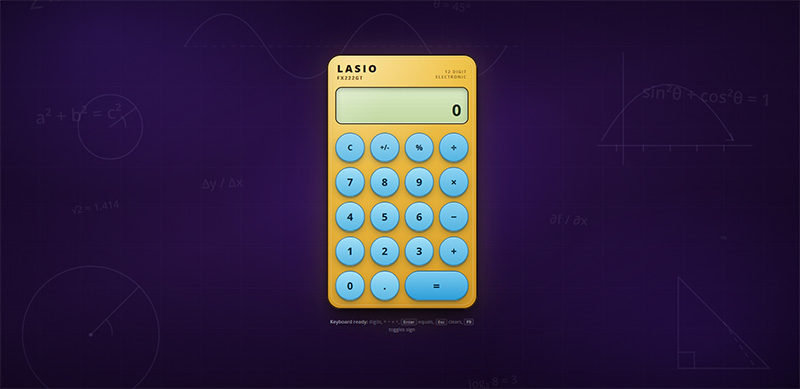

# LASIO fx222GT Calculator

A reference-style desktop calculator built as a single static web page. It recreates the look of a classic yellow-ochre **LASIO fx222GT** pocket calculator — round sky-blue keys, a pale green LCD, and a deep violet math-themed backdrop — using only HTML, Tailwind CSS, and vanilla JavaScript.

No build step, no framework, no CSS file.



*The LASIO fx222GT calculator interface.*

---

## Features

- **Four-function arithmetic** — addition, subtraction, multiplication, and division.
- **Percent** — context-aware: `200 + 10 %` calculates 10 % of 200, while a standalone `50 %` becomes `0.5`.
- **Sign toggle** — flip the current value between positive and negative.
- **Decimals** — full decimal input with duplicate-dot protection.
- **Repeated equals** — press `=` again to re-apply the last operation.
- **Chained operations** — `2 + 3 × 4` evaluates left-to-right as you go, like a physical calculator.
- **Backspace** — delete the last entered digit.
- **Graceful divide-by-zero** — shows `Cannot divide by 0` in a muted red, then recovers on the next input or clear.
- **No display overflow** — values are capped at 12 input digits and the font steps down (`md → sm → xs`) until the number fits the LCD. Very large/small results switch to exponential notation.
- **Thousands separators** — grouped integer digits for readability.
- **Full keyboard support** — every action has a key binding, and the matching button flashes when pressed.
- **Responsive layout** — centered and usable from 320 px phones up to wide desktops.
- **Accessible controls** — semantic `<button>` elements, descriptive `aria-label`s, `aria-live` output, visible focus rings, and reduced-motion support.

---

## Project Structure

```
Default Project/
├── index.html               # Markup, Tailwind CDN config, decorative SVG background
├── script.js                # Calculator state machine, DOM updates, keyboard handling
├── calculator-img-2026.jpg  # Screenshot used in this README
└── README.md
```

There is intentionally **no CSS file**. All styling lives in Tailwind utility classes, plus custom theme tokens (gradients, shadows) declared in the inline `tailwind.config` inside `index.html`.

---

## Getting Started

### Option 1 — Open the file directly

Double-click `index.html`, or drag it into a browser.

> Some browsers restrict fonts/CDN loading from `file://`. If the page looks unstyled, use Option 2.

### Option 2 — Serve locally (recommended)

Any static server works. For example, with Python:

```bash
python -m http.server 8000
```

Then open <http://localhost:8000>.

Or with Node.js:

```bash
npx serve .
```

An internet connection is required on first load for:

- Tailwind CSS via `https://cdn.tailwindcss.com`
- Open Sans via Google Fonts

---

## Usage

### Mouse / touch

Click or tap the on-screen keys.

### Keyboard shortcuts

| Key | Action |
| --- | --- |
| `0`–`9` | Enter digits |
| `.` or `,` | Decimal point |
| `+` | Add |
| `-` | Subtract |
| `*` or `x` / `X` | Multiply |
| `/` | Divide |
| `%` | Percent |
| `Enter` or `=` | Equals |
| `Esc` or `Delete` | Clear all |
| `Backspace` | Delete last digit |
| `F9` | Toggle sign |

When a button has focus, `Enter` and `Space` activate it natively instead of triggering the global shortcut.

---

## How It Works

`script.js` is a small state machine wrapped in an IIFE. Its state tracks:

| Field | Purpose |
| --- | --- |
| `current` | The value currently shown on the LCD |
| `previous` | The left-hand operand of a pending operation |
| `operator` | The pending operator (`+`, `-`, `*`, `/`) |
| `waitingForOperand` | Whether the next digit starts a new operand |
| `justEvaluated` | Enables repeated-equals behavior |
| `lastOperator` / `lastOperand` | Stored operation for repeated equals |
| `error` | Locks input after divide-by-zero until reset |
| `expression` | The small history line above the main display |

Rendering is handled by `updateDisplay()`, which:

1. Formats the value with grouping and error/expression text.
2. Toggles the `is-error` class for the red error color.
3. Tries the `md`, `sm`, and `xs` display sizes until `scrollWidth <= clientWidth`.

Button presses are delegated from the keypad container, and keyboard input is handled by a single `document` keydown listener. Keyboard presses add an `is-pressed` class for 120 ms to mirror the physical button press.

---

## Customization

### Colors, gradients, and shadows

Open `index.html` and edit the `tailwind.config` block in the `<head>`:

```js
tailwind.config = {
  theme: {
    extend: {
      backgroundImage: {
        "calculator-body": "...", // yellow-ochre body
        lcd: "...",               // pale green screen
        btn: "...",               // sky-blue key
      },
      boxShadow: {
        calculator: "...",
        btn: "...",
      },
    },
  },
};
```

### Display sizing

The LCD uses Tailwind arbitrary values and `data-size` variants on `#display`:

```html
<output
  id="display"
  class="... text-[clamp(2.1rem,10vw,2.4rem)]
         data-[size=sm]:text-[clamp(1.6rem,7.5vw,1.8rem)]
         data-[size=xs]:text-[clamp(1.15rem,5.5vw,1.3rem)]"
  data-size="md"
></output>
```

`script.js` only changes `data-size`; the styling stays in Tailwind.

### Input limit

Change `MAX_INPUT_DIGITS` in `script.js`:

```js
const MAX_INPUT_DIGITS = 12;
```

### Error message

Change `ERROR_MESSAGE` in `script.js`:

```js
const ERROR_MESSAGE = "Cannot divide by 0";
```

---

## Accessibility

- All keys are real `<button type="button">` elements with `aria-label`s.
- The keypad is grouped with `role="group"` and an accessible name.
- The display is an `<output>` with `aria-live="polite"` and `aria-atomic="true"`.
- The expression/history line is marked `aria-hidden` to avoid duplicate announcements.
- Focus-visible styling draws a high-contrast cream and violet ring.
- Transitions are disabled under `prefers-reduced-motion`.
- Lighthouse scores: **Accessibility 100**, **Best Practices 100**, **SEO 100**.

---

## Browser Support

Works in current versions of Chrome, Edge, Firefox, and Safari. It relies on modern CSS features including:

- CSS `clamp()`
- `:focus-visible`
- `svh` viewport units
- Tailwind arbitrary variants/properties

---

## Notes and Limitations

- The Tailwind CDN is intended for prototyping and learning. For production, install Tailwind and generate a static stylesheet.
- The calculator evaluates left-to-right with no operator precedence, matching typical handheld calculators.
- There are no memory keys (`M+`, `M-`, `MR`, `MC`), square roots, or scientific functions.
- Values are limited to 12 input digits and results outside roughly `1e-9` to `1e12` use exponential notation.

---

## License

This project is provided as-is for personal and educational use. The LASIO and fx222GT names are used only to evoke the reference design.
